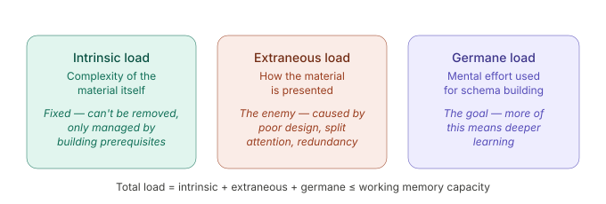
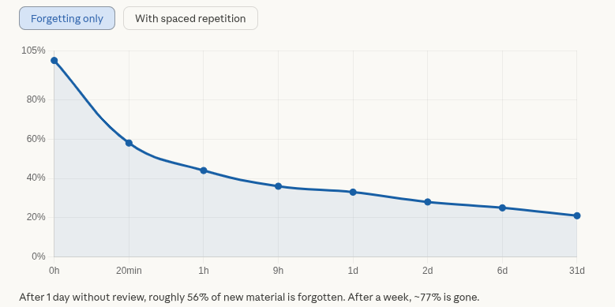
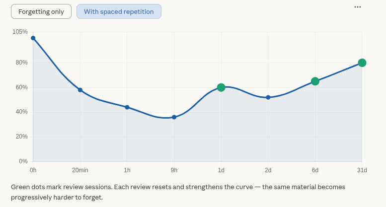
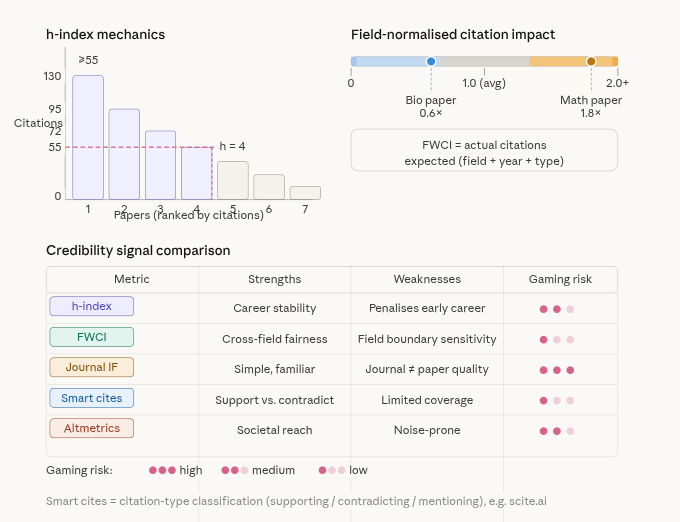

# 🧠 Learning Efficiency Tracker 2.0

> A PhD research intelligence system for tracking, measuring, and optimising learning sessions across AI & Cyber Forensics research domains built on three interlocking theories of how humans acquire, retain, and evaluate knowledge.

[](https://python.org)
[](https://djangoproject.com)
[](https://reactjs.org)
[](https://vitejs.dev)
[](LICENSE)
[]()
[]()

---
### Introduction

Education systems in Sub-Saharan Africa face compounding challenges at the intersection of data governance, stakeholder communication, and equitable learning outcomes. In Kenya, a country that processes nearly one million secondary school candidates annually through its national Kenya Certificate of Secondary Education (KCSE) examination, systemic vulnerabilities have become increasingly visible. The 2023 examination cycle revealed serious data integrity failures, including incorrect index number allocations and mismatched student records, highlighting weaknesses across the data availability, confidentiality, and integrity (ACI) triad.

Simultaneously, a longitudinal analysis of KCSE performance reveals that approximately 48,000 students, roughly five per cent of all candidates, have consistently received an E (fail) grade for at least nine consecutive years. This pattern is not random noise; it points to structural, behavioural, and environmental factors that conventional data management systems have failed to identify, let alone address.

This paper proposes a theoretically grounded, mathematically formalised framework for a secure AI-driven education system prototype that addresses both challenges simultaneously. The core insight is that the problem is systemic: it cannot be solved by a data management application alone, nor by isolated improvements to examination administration. What is required is a real-time, multi-stakeholder analytical platform that integrates cybersecurity safeguards, machine learning anomaly detection, and structured collaboration among the three primary education actors the Student, the Teacher, and the Parent, collectively termed the Education Triad.

The mathematical backbone of the framework draws on quadratic iteration theory, specifically the recurrence relation Xn+1 = X²n, which has been applied successfully in modelling chaotic and complex systems across population dynamics, financial modelling, and engineering. Adapting this to an AI and cybersecurity education context constitutes a novel contribution. The resulting prototype, Learning Efficiency 2.0, is available as an open-source application at github.com/mngugi/Learning_Efficiency2_0.


---

## Concept

Designed by a PhD candidate in AI and Cyber Forensics, this system automates the measurement of learning efficiency across study sessions. Rather than tracking time alone, it quantifies the relationship between productive output and unresolved friction, giving a scientific score to every research session.

> The system is not a productivity app. It is a **live knowledge density map**,  a running measure of how efficiently a researcher converts study
> time into a durable, connected understanding across six research pillars.

The architecture is grounded in three peer-reviewed learning science frameworks, each of which contributes a variable to the core efficiency formula:

| Theory | Author | Year | Variable Contributed |
|--------|--------|------|---------------------|
| **Cognitive Load Theory** | John Sweller | 1988 | `Kg` - Cognitive sverhead at session time |
| **Ebbinghaus Forgetting Curve** | Hermann Ebbinghaus | 1885 | `Ts` - Time-on-task relative to retention decay |
| **Bibliometric Credibility Weighting** | Hirsch, Garfield et al. | 1955–2005 | `Rq` - Source quality weighting per session |

---

## Efficiency Formula

```
Learning Efficiency (Le) = (Time Spent × Concept Links) / (Knowledge Gaps × Research Questions)
```

Expanded:

$$
L_e = \frac{T_s \times C_l}{K_g \times R_q}
$$

| Symbol | Variable | Range | Theoretical Grounding |
|--------|----------|-------|-----------------------|
| `Ts` | Time Spent (hours) | > 0 | **Ebbinghaus** - time-on-task relative to forgetting curve position |
| `Cl` | Concept Links | ≥ 1 | **Sweller** - germane load output; schema connections formed |
| `Kg` | Knowledge Gaps remaining | ≥ 1 | **Sweller** - intrinsic + extraneous load not yet resolved |
| `Rq` | Research Questions open | ≥ 1 | **Bibliometrics** - open credibility-weighted questions remaining |

**Max Efficiency**: assumes all gaps and questions are resolved:
```
Max Efficiency = (Ts × Cl) / (1 × 1)
```

**Efficiency Percentage**: how close the session reached its own theoretical maximum:
```
Efficiency % = (Le / Max Efficiency) × 100
```

### Rating Scale

| Rating | Threshold | Theoretical Interpretation |
|--------|-----------|---------------------------|
| 🟢 Excellent | ≥ 80% | Low cognitive load, high schema formation, credible sources |
| 🔵 Good | ≥ 60% | Managed load, moderate open questions, good source quality |
| 🟡 Average | ≥ 40% | Mixed load distribution, some unresolved friction |
| 🔴 Needs Work | < 40% | High extraneous load or low-credibility sources dominating |

---

## Theoretical Foundations

### Theory 1 · Cognitive Load Theory- Sweller (1988)

**Why it matters here:** The variables `Kg` (Knowledge Gaps) and `Cl` (Concept Links) are direct operationalisations of Sweller's three-load model. Every research session generates a cognitive load profile, and this system captures it.

#### The Architecture of Working Memory

Working memory is the bottleneck of all learning. It holds approximately **4 chunks** of information at a time, for only seconds to minutes. Every piece of knowledge, every schema about AI forensic attribution, adversarial ML, or legal frameworks, must be built through this narrow channel.

```

┌─────────────────────────────────────────────────────────────────────┐
│                          WORKING MEMORY                             │
│                     (~4 slots · seconds to minutes)                 │
├────────────────────┬────────────────────┬───────────────────────────┤
│   INTRINSIC LOAD   │  EXTRANEOUS LOAD   │      GERMANE LOAD         │
│                    │                    │                           │
│ Complexity of the  │  - Caused by poor  │  Schema-building effort   │
│  material itself   │  presentation,     │  - the GOAL of all        │
│                    │  split attention,  │  research sessions        │
│ e.g., understanding│  redundancy,       │                           │
│  LLM fingerprinting│  unclear sources   │ ,  e.g., connecting LLM   │
│  is inherently     │                    │  forensic to legal        │
│  high-intrinsic    │  Eliminate this    │  attribution framework    │
│                    │                    │                           │
│  Fixed — managed   │  Minimise          │  Maximise                 │
│  via prerequisites │                    │                           │
└────────────────────┴────────────────────┴───────────────────────────┘
   Total Load = Intrinsic + Extraneous + Germane ≤ Working Memory Capacity

```

#### How `Kg` and `Cl` Map to This Model

| API Field | Load Type | Interpretation |
|-----------|-----------|----------------|
| `concept_links` (high) | Germane | Schema formation is occurring,connections being built |
| `knowledge_gaps` (low) | Intrinsic + Extraneous | Unresolved complexity is being managed |
| `knowledge_gaps` (high) | Overload signal | Working memory exceeded; session should be split |
| `recurring_gap = True` | Persistent intrinsic | A concept repeatedly exceeding capacity — needs prerequisite work |

#### Cognitive Load by Session Type

Different session types carry different baseline load profiles:

```
Session Type    Intrinsic    Extraneous    Germane     Strategy
─────────────────────────────────────────────────────────────────────
PAPER           High         Medium        High        Active annotation,
                                                       not passive reading
CODING          Medium       Low           Very High   Worked examples
                                                       before open problems
WRITING         Low          Low           Very High   Ideal for schema
                                                       consolidation
SEMINAR         High         Variable      Medium      Pre-read to reduce
                                                       intrinsic load
REVIEW          Medium       Low           Very High   Spaced retrieval —
                                                       see Theory 2
EXPERIMENT      Very High    Low           High        Split into phases
```

#### The Expertise Reversal Effect

As PhD research matures, the load profile of the same material changes:

```
Early PhD (novice):
  Paper on adversarial ML  →  Cl = 2, Kg = 8  →  Le = low  (intrinsic overwhelms)

Mid PhD (developing):
  Same paper               →  Cl = 7, Kg = 3  →  Le = high (schemas absorb content)

Late PhD (expert):
  Worked examples in paper →  Kg INCREASES     →  expertise reversal effect
  (explicit guidance becomes redundant noise for expert schemas)
```

> **System implication:** Track `Cl/Kg` ratio across time. A rising ratio on the same pillar confirms genuine expertise development, one of the most valuable signals in this tracker.

---

**Further Reading**

**Theory 1: Cognitive Load Theory, Sweller (1988)**

At its core, this theory asks: why do people struggle to learn even when they're trying hard? John Sweller answered that the problem isn't motivation, it's mental bandwidth.



**The key insight:** working memory is the bottleneck. It holds roughly 4 items at a time for only seconds. Long-term memory is vast, but must be reached through working memory. Learning = building schemas in long-term memory. If working memory fills up before schemas form, nothing sticks.
Sweller identified three types of cognitive load that fill those slots:



**The practical design goal:** reduce extraneous load to near zero so that whatever working memory capacity remains can be split between intrinsic load (unavoidable) and germane load (the actual learning).
Advanced applications of CLT include the expertise reversal effect,  which helps novices but actually hurts experts, because experts already have schemas, and the extra guidance becomes noise. It also underpins the split-attention effect (don't separate diagrams from their labels), redundancy effect (don't present the same info twice in different formats), and modality effect (voice + image uses two separate channels; text + image competes on one).


---

### Theory 2 · Ebbinghaus Forgetting Curve (1885)

**Why it matters here:** `Ts` (Time Spent) is not a neutral input. Its value depends critically on *when* in the forgetting curve a session occurs. Two hours of review on day 1 and two hours on day 30 are not equivalent; the second is exponentially more consolidating.

#### The Mathematics of Forgetting

Ebbinghaus proposed the retention formula:

$$
R = e^{-t/S}
$$

Where:
- `R` = memory retention (0.0 to 1.0)
- `t` = time elapsed since last encoding or retrieval
- `S` = memory stability - increases with each successful retrieval event
- `e` = Euler's number (~2.718)

```
Retention (R)
  1.00 │▓
       │ ▓▓
  0.75 │    ▓▓▓
       │        ▓▓▓▓
  0.50 │             ▓▓▓▓▓
       │                   ▓▓▓▓▓▓
  0.25 │                         ▓▓▓▓▓▓▓▓▓▓▓▓▓▓▓▓▓▓▓▓▓▓
       └──────────────────────────────────────────────────▶  Time
         20min  1hr   9hr   1day  2days  6days  31days

  Without intervention, ~77% of a session is forgotten within 6 days.
```

#### Spaced Repetition: The Optimal Review Schedule

Each successful retrieval flattens the next forgetting curve. Memory stability `S` grows with every review, meaning the same material becomes progressively harder to forget.

```
Optimal review intervals for PhD-level material:

  Encode ──► Review 1  ──► Review 2  ──────► Review 3  ─────────────►
  (session)  (1 day)      (6 days)            (14 days)
     │
     └── Each review raises S, so the next curve is shallower
         A concept reviewed 5 times at correct intervals
         approaches permanent retention

Research Pillar Scheduling (recommended):
─────────────────────────────────────────────────────────
  AI Forensics session today
  → REVIEW session in 1 day
  → PAPER session in 6 days (different aspect, same pillar)
  → WRITING session in 14 days (consolidation via output)
  → SEMINAR or EXPERIMENT in 30 days
```

#### Spaced Repetition Intervals

| Review # | Interval | `S` Change | Retention at Next Due Date |
|----------|----------|------------|---------------------------|
| 1st | 1 day | +0.5 | ~90% |
| 2nd | 6 days | +1.2 | ~88% |
| 3rd | 14 days | +2.8 | ~85% |
| 4th | 30 days | +5.0 | ~83% |
| 5th+ | 60+ days | +9.0 | Near-permanent |

#### The Testing Effect (Roediger & Karpicke, 2006)

Retrieval practice is more powerful than re-reading. A `REVIEW` session that involves active recall produces higher true knowledge retention than a `PAPER` session of the same duration, even when the immediate subjective score feels lower.

```
Passive re-reading of a paper:        Kg drops slowly, Cl rises slowly
Active retrieval (REVIEW session):    Kg drops sharply in the short term,
                                      but true S increases significantly

→ Short-term Le score may be lower for REVIEW sessions
→ Long-term retained knowledge is higher
→ The system should weight REVIEW sessions differently in analytics
```

#### Desirable Difficulties (Bjork, 1994)

Conditions that feel harder during study produce more durable learning:

| Difficulty | Session Type | Effect on `Le` |
|------------|-------------|----------------|
| Spaced practice | REVIEW after gap | Short-term `Kg` rises, long-term retention gains |
| Interleaving | Mixed pillar sessions | `Cl` initially lower, cross-pillar links stronger |
| Retrieval practice | REVIEW, WRITING | Active recall > passive exposure |
| Generation effect | EXPERIMENT, HYPOTHESIS | Generating answers > reading them |

> **Roadmap implication:** The planned `forgetting_decay` field will apply `R = e^(−t/S)` retroactively to `Kg` scores, adjusting historical sessions to reflect true retained knowledge, not just what was scored at session time.

---
### Further Reading

**Theory 2: The Ebbinghaus Forgetting Curve**

- Hermann Ebbinghaus (1880s–1885) ran the first rigorous experiments on memory, on himself, memorising thousands of nonsense syllables. What he discovered was unsettling: without reinforcement, memory decays in a predictable, rapid curve.



---




- The curve isn't just steep, it's fast. Most forgetting happens within the first hour. By day six, only a quarter of unreviewed material survives.

**What Ebbinghaus also discovered:** Each time you successfully retrieve a memory, the subsequent forgetting curve becomes shallower. This is the basis of spaced repetition reviewing material at increasing intervals just before you forget it.
The mathematical form he proposed: R = e^(- t/S), where R = retention, t = time, and S = memory stability (which increases with each review). Modern systems like Anki and SuperMemo are direct descendants of this formula.

**Advanced layers:** Ebbinghaus's model was refined into the desirable difficulties theory (Bjork, 1994), retrieval practice, interleaving, and spacing, all of which make learning feel harder but produce more durable learning. The distinction between storage strength (how well consolidated a memory is) and retrieval strength (how accessible it is right now) explains why cramming can feel effective but fades fast. The testing effect (Roediger & Karpicke, 2006) showed that a test is a more powerful learning event than a second reading, because retrieval, not re-exposure, is what cements memory.


---

### Theory 3 · Bibliometric Credibility Weighting

**Why it matters here:** `Rq` (Research Questions) is not simply a count;  it is a **credibility-weighted** measure. An open question sourced from a Nature paper carries different epistemic weight than one from a forum post. This theory provides the framework for that weighting.

#### The Credibility Hierarchy

```
Level 3: Network Measures  (most sophisticated)
┌──────────────────────┬─────────────────────┬─────────────────────┐
│  Eigenfactor /       │  Co-citation        │  Altmetrics         │
│  PageRank            │  Analysis           │                     │
│                      │                     │                     │
│  Weight citations    │  Papers cited       │  Policy, media,     │
│  by WHO is citing    │  together reveals    │  social mentions   │
│  not just HOW MANY   │  knowledge clusters │  = real-world impact│
└──────────────────────┴─────────────────────┴─────────────────────┘
         ▲                      ▲                      ▲
Level 2: Normalised Indices
┌──────────────────────┬─────────────────────┬─────────────────────┐
│  h-index             │  i10-index          │  Field-normalised   │
│  (Hirsch, 2005)      │                     │  citation score     │
│                      │                     │                     │
│  h papers each cited │  Papers with 10+    │  Citations ÷ field  │
│  ≥ h times           │  citations          │  & year average     │
└──────────────────────┴─────────────────────┴─────────────────────┘
         ▲                      ▲                      ▲
Level 1 Raw Counts
┌──────────────────────┬─────────────────────┬─────────────────────┐
│  Citation count      │  Impact factor      │  Publication count  │
│  Times cited         │  Journal-level      │  Total output       │
│  by others'          │  average cites      │  volume             │
└──────────────────────┴─────────────────────┴─────────────────────┘
```

#### Source Credibility Tiers for `Rq` Weighting

When logging a session, the number of `research_questions` should be weighted by the credibility tier of the source that raised them:

```
Source Tier      Rq Weight   Bibliometric Signal
──────────────────────────────────────────────────────────────────────
Tier 1 Journals  × 1.0       Q1 SCImago, Eigenfactor > 0.01,
                             field-normalised citation > 2.0
                             e.g., IEEE Trans. Info. Forensics, USENIX

Peer-reviewed    × 0.85      h-index authors, i10-index > 10,
Conferences                  cited in systematic reviews
                             e.g., ACM CCS, IEEE S&P, CVPR

Preprints        × 0.65      arXiv, SSRN-traceable, versioned,
                             not yet peer-reviewed

Grey Literature  × 0.45      NIST reports, ENISA guidelines,
                             institutional white papers

Informal Sources × 0.25      Technical blogs with citations,
                             documented forum discussions

Uncredentialed   × 0.05      No author, no date, no citations
```

#### Credibility Weighting by Research Pillar

Some pillars in this system are more citation-dense than others:

| Pillar | Key | Citation Density | Recommended Rq Weighting |
|--------|-----|-----------------|--------------------------|
| AI Forensics | `AI_FORENSICS` | Medium-High | Tier 1 + Conferences |
| Cyber Security | `CYBER_SECURITY` | High | Conferences dominant |
| Legal & Forensic Framework | `LEGAL_FRAMEWORK` | Medium | Grey literature valid |
| Adversarial ML | `ML_ADVERSARIAL` | Very High | arXiv + Tier 1 |
| AI Attack Attribution | `ATTRIBUTION` | Low-Medium | Emerging field — preprints common |
| Tools & Methodology | `TOOLS_METHODS` | Low | Grey + informal common |

#### The Semantic Turn in Bibliometrics

Modern tools have moved beyond citation counts toward **semantic credibility** - classifying whether a citing paper *supports*, *contradicts*, or merely *mentions* a claim:

| Platform | Method | Signal |
|----------|--------|--------|
| Scite.ai | Smart citations | Supporting vs. contradicting citations |
| Semantic Scholar | SPECTER embeddings | Conceptual similarity mapping |
| Connected Papers | Co-citation graph | Visual knowledge cluster navigation |
| Lens.org | Open citation graph | Full metadata + patent citations |

> **Roadmap implication:** The planned `literature_reference_linking` feature will pull DOI-level credibility scores from Crossref and Semantic Scholar APIs — automatically assigning source tier weights to `Rq` values without manual entry.

### Further Reading 

**Theory 3: Research Quality Indexing — Bibliometric Credibility Weighting**

- This is the most applied of the three — it asks: how do we measure the quality and influence of academic work?
Bibliometrics is the quantitative analysis of publications, citations, and their networks. Let's build up from primitives.



**Level 1 — Raw counts:** The most naive measure. More citations = more influential. Problem: A paper published in 1980 naturally has more citations than one from 2022, and a biology paper will always have more citations than a mathematics paper (different field norms).

**Level 2 — Normalised indices:** The h-index (Hirsch, 2005) balances breadth and depth. An h-index of 20 means 20 papers each cited at least 20 times. It resists gaming via a single viral paper. Field normalisation divides a paper's citation count by the average for that field and year.

**Level 3 — Network measures:** Eigenfactor and PageRank treat citations like votes, but weight votes from high-influence journals more heavily (the same logic Google uses for web pages). Co-citation analysis maps the structure of knowledge — papers cited together are likely about the same topic, revealing invisible intellectual communities.

**Advanced credibility weighting combines multiple signals:** journal tier (SCImago quartile ranking), citation velocity (is this paper gaining or losing influence?), retraction status, replication success rates, funding source disclosure, and altmetrics. Systematic review tools like Rayyan and platforms like Scite.ai now use AI to classify whether citing papers support, contradict, or merely mention a claim,  moving beyond raw counts toward semantic credibility


---

## How the Three Theories Interact

The formula is not arbitrary. It is a compression of a three-way feedback loop:

```
┌─────────────────────────────────────────────────────────────────────┐
│                                                                     │
│   BIBLIOMETRICS                                                     │
│   sets source credibility                                           │
│   → weights Rq                                                      │
│   → poor sources contaminate Kg                                     │
│     (bad inputs corrupt retained knowledge)                         │
│                          │                                          │
│                          ▼                                          │
│   COGNITIVE LOAD THEORY                                             │
│   governs session design                                            │
│   → high Kg = working memory not cleared                            │
│   → low Cl = schemas not forming                                    │
│   → Cl/Kg ratio = expertise development signal                      │
│                          │                                          │
│                          ▼                                          │
│   EBBINGHAUS                                                        │
│   governs when to return                                            │
│   → Kg logged today ≠ Kg retained in 6 days                         │
│   → Ts invested now decays without REVIEW sessions                  │
│   → spaced repetition raises S, protects Le over time               │
│                          │                                          │
│                          └──────────────────────────────────────┐   │
│                                                                  │  │
│   MAXIMUM Le requires all three simultaneously:                  │  │
│   credible sources (Bibliometrics) +                             │  │
│   managed cognitive load (CLT) +                                 │  │
│   retrieval-spaced sessions (Ebbinghaus)           ◄────────────┘   │
│                                                                     │
└─────────────────────────────────────────────────────────────────────┘
```

**Practical example from the AI Forensics pillar:**

```
Session A: Poor theoretical practice
  title:      "LLM attribution — blog survey"
  Ts:         3.0 hrs
  Cl:         2    (few connections formed)
  Kg:         9    (many gaps — low-credibility sources raised questions
                    without grounding them)
  Rq:         8    (unweighted open questions from informal sources)
  Le:         3.0 / 72  =  0.08   →  Needs Work

Session B: Theory-aligned practice
  title:      "LLM attribution IEEE Trans. review"
  Ts:         3.0 hrs
  Cl:         8    (Tier 1 paper connected to 3 existing pillar schemas)
  Kg:         2    (most gaps resolved by high-credibility sourcing)
  Rq:         2    (2 well-scoped open questions from citable literature)
  Le:         24.0 / 4  =  6.0    →  Excellent

Same 3 hours. Very different knowledge output.
```

---

## Tech Stack

| Layer | Technology | Role |
|-------|------------|------|
| Backend | Django 4.x + Django REST Framework | API server, ORM, admin |
| Database | SQLite (dev) / PostgreSQL (prod) | Session and gap persistence |
| Frontend | React 18 + Vite | Live dashboard |
| Charts | Recharts | Efficiency visualisation |
| Routing | React Router DOM | Dashboard navigation |
| Styling | Custom CSS (terminal/forensics aesthetic) | Research-grade UI |

---

## Project Structure

```
Learning_Efficiency2.0/
├── config/                        # Django project configuration
│   ├── settings.py
│   ├── urls.py
│   ├── wsgi.py
│   └── asgi.py
│
├── research/                      # Core Django application
│   ├── models.py                  # LearningRecord, ResearchPillar, KnowledgeGapTracker
│   ├── views.py                   # ViewSets + Dashboard
│   ├── serializers.py             # API serializers
│   ├── urls.py                    # Router registration
│   └── migrations/
│
├── frontend/                      # React application
│   ├── package.json
│   ├── vite.config.js
│   └── src/
│       ├── main.jsx
│       ├── App.jsx
│       └── components/
│           ├── phd_dashboard.jsx        # Mock data version
│           └── phd_dashboard_full.jsx   # Live API version
│
├── start.sh                       # One-command startup script
├── manage.py
├── db.sqlite3
└── README.md
```

---

## Data Models

### Learning Record
Represents a single study session with full CLT + Ebbinghaus instrumentation.

| Field | Type | Description | Theory Link |
|-------|------|-------------|-------------|
| `title` | CharField | Session title | — |
| `pillar` | ForeignKey | Research domain | Bibliometrics — domain credibility context |
| `session_type` | CharField | PAPER, CODING, WRITING, SEMINAR, REVIEW, EXPERIMENT | CLT — load profile varies by type |
| `time_spent` | FloatField | Hours invested | Ebbinghaus — Ts in forgetting model |
| `concept_links` | FloatField | Concepts connected | CLT — germane load output (schema formation) |
| `knowledge_gaps` | FloatField | Gaps remaining | CLT — intrinsic + extraneous load residual |
| `research_questions` | FloatField | Open questions raised | Bibliometrics — credibility-weighted open claims |
| `learning_efficiency` | FloatField | Auto-calculated on save | Le formula output |
| `max_efficiency` | FloatField | Auto-calculated on save | Theoretical ceiling for this session |
| `output_type` | CharField | NOTES, DRAFT, CODE, HYPOTHESIS, DIAGRAM, NONE | CLT — germane load confirmation |
| `output_notes` | TextField | Description of output produced | — |
| `recurring_gap` | BooleanField | Flags a recurring knowledge gap | CLT — persistent intrinsic load signal |
| `gap_description` | TextField | Description of the gap | CLT — load analysis input |

### ResearchPillar
Top-level research domains. Bibliometric credibility context varies per pillar.

| Pillar | Key | Dominant Citation Tier |
|--------|-----|------------------------|
| AI Forensics | `AI_FORENSICS` | IEEE Transactions, ACM |
| Cyber Security | `CYBER_SECURITY` | USENIX, IEEE S&P, CCS |
| Legal & Forensic Framework | `LEGAL_FRAMEWORK` | Law reviews, NIST |
| Adversarial Machine Learning | `ML_ADVERSARIAL` | arXiv, NeurIPS, ICML |
| AI Attack Attribution | `ATTRIBUTION` | Emerging — preprints |
| Tools & Methodology | `TOOLS_METHODS` | Mixed |

### Knowledge Gap Tracker
Tracks recurring knowledge gaps across sessions — the persistent intrinsic load signal.

| Field | Type | Description | Theory Link |
|-------|------|-------------|-------------|
| `gap` | CharField | Gap description | CLT — intrinsic load node |
| `pillar` | ForeignKey | Research domain | Bibliometrics — source context |
| `sessions` | ManyToManyField | Linked sessions | Ebbinghaus — recurrence tracks forgetting |
| `status` | CharField | OPEN, IN_PROGRESS, RESOLVED | CLT — load resolution tracking |
| `resolution_notes` | TextField | How the gap was resolved | — |
| `resolved_at` | DateTimeField | Resolution timestamp | Ebbinghaus — S increase event |

---

## API Endpoints

| Method | Endpoint | Description |
|--------|----------|-------------|
| GET / POST | `/api/v1/records/` | List or create sessions |
| GET / PUT / DELETE | `/api/v1/records/{id}/` | Single session |
| GET | `/api/v1/records/top_sessions/` | Top 5 by efficiency |
| GET | `/api/v1/records/weak_sessions/` | Bottom 5 by efficiency |
| GET / POST | `/api/v1/pillars/` | List or create pillars |
| GET | `/api/v1/pillars/{id}/sessions/` | Sessions per pillar |
| GET | `/api/v1/pillars/{id}/gaps/` | Gaps per pillar |
| GET / POST | `/api/v1/gaps/` | List or create gaps |
| POST | `/api/v1/gaps/{id}/resolve/` | Resolve a gap |
| GET | `/api/v1/dashboard/summary/` | Full dashboard summary |

### Query Filters

```bash
GET /api/v1/records/?pillar=AI_FORENSICS
GET /api/v1/records/?session_type=PAPER
GET /api/v1/records/?recurring_gaps=true
GET /api/v1/records/?has_output=true
GET /api/v1/gaps/?status=OPEN
```

---

## Installation

### Prerequisites

- Python 3.10+
- Node.js 18+
- pip
- npm

### Backend Setup

```bash
# Clone the repository
git clone https://github.com/mngugi/Learning_Efficiency2_0.git
cd Learning_Efficiency2_0

# Install Python dependencies
pip install django djangorestframework django-cors-headers

# Run migrations
python manage.py makemigrations
python manage.py migrate

# Create superuser (optional)
python manage.py createsuperuser

# Start Django
python manage.py runserver
```

### Frontend Setup

```bash
cd frontend
npm install
npm run dev
```

### One-Command Startup (after first install)

```bash
./start.sh
```

---

## Running the App

| Server | URL |
|--------|-----|
| React Dashboard | http://localhost:5173/live |
| Django API | http://localhost:8000/api/v1/ |
| Django Admin | http://localhost:8000/admin/ |

---

## CORS Configuration

Required for React to communicate with Django:

```python
# config/settings.py
INSTALLED_APPS = [
    ...
    "corsheaders",
]

MIDDLEWARE = [
    "corsheaders. middleware.CorsMiddleware",  # must be first
    ...
]

CORS_ALLOW_ALL_ORIGINS = True  # tighten in production
```

---

## start.sh

```bash
#!/bin/bash
echo "Running migrations..."
cd /path/to/Learning_Efficiency2_0
python manage.py makemigrations
python manage.py migrate

echo "Starting Django..."
python manage.py runserver &

echo "Starting React..."
cd /path/to/Learning_Efficiency2_0/frontend
npm run dev &

echo ""
echo "✅ Django  → http://localhost:8000"
echo "✅ React   → http://localhost:5173/live"
```

---

## Example Session — Full Workflow

```bash
POST /api/v1/records/
Content-Type: application/json

{
    "title": "LLM Fingerprinting via Output Stylometry — IEEE Review",
    "pillar": "AI_FORENSICS",
    "session_type": "PAPER",
    "time_spent": 3.5,
    "concept_links": 9,
    "knowledge_gaps": 2,
    "research_questions": 3,
    "output_type": "NOTES",
    "output_notes": "Mapped stylometric features to 4 known LLM families. Gap: no dataset for sub-7B models.",
    "recurring_gap": false,
    "gap_description": ""
}
```

### Response

```json
{
    "id": 14,
    "title": "LLM Fingerprinting via Output Stylometry — IEEE Review",
    "pillar": "AI_FORENSICS",
    "session_type": "PAPER",
    "time_spent": 3.5,
    "concept_links": 9.0,
    "knowledge_gaps": 2.0,
    "research_questions": 3.0,
    "learning_efficiency": 5.25,
    "max_efficiency": 31.5,
    "efficiency_percentage": 16.67,
    "efficiency_grade": "Good",
    "output_type": "NOTES",
    "output_notes": "Mapped stylometric features to 4 known LLM families.",
    "recurring_gap": false,
    "created_at": "2025-03-15T09:42:00Z"
}
```

### Dashboard Summary

```bash
GET /api/v1/dashboard/summary/
```

```json
{
    "total_sessions": 47,
    "mean_efficiency": 5.84,
    "max_efficiency_recorded": 18.20,
    "min_efficiency_recorded": 0.31,
    "stdev_efficiency": 3.72,
    "total_study_hours": 164.5,
    "total_concept_links": 612,
    "open_knowledge_gaps": 23,
    "recurring_gaps": 7,
    "sessions_by_pillar": {
        "AI_FORENSICS": 18,
        "CYBER_SECURITY": 11,
        "ML_ADVERSARIAL": 9,
        "ATTRIBUTION": 5,
        "LEGAL_FRAMEWORK": 3,
        "TOOLS_METHODS": 1
    },
    "sessions_by_type": {
        "PAPER": 21,
        "CODING": 10,
        "REVIEW": 8,
        "WRITING": 5,
        "EXPERIMENT": 2,
        "SEMINAR": 1
    }
}
```

---

## Research Context

This system was built to support PhD research in **AI and Cyber Forensics**, with a focus on the following open research questions:

- How do you forensically attribute an attack when the attacker used an AI system to execute it?
- Can LLM-generated artefacts be forensically distinguished from human-written ones?
- Can you fingerprint which AI model was used in an attack?
- What is the legal framework for AI-assisted crime attribution?
- Can AI forensic tools out-think AI attack tools?

The learning tracker serves as both a productivity tool and a live map of the researcher's **knowledge density** across these domains — surfacing which pillars are deeply consolidated, which carry persistent gaps, and which need retrieval-spaced review before the next research sprint.

---

## Roadmap

### Theory-Grounded Extensions

- [ ] `forgetting_decay` field — apply `R = e^(−t/S)` to `Kg` scores retroactively (Ebbinghaus)
- [ ] Spaced repetition scheduler — surface sessions due for REVIEW at optimal intervals per pillar
- [ ] `Rq` auto-scoring — DOI lookup against Crossref / Semantic Scholar for source credibility tier
- [ ] `Cl` growth curve — plot concept link velocity per pillar to confirm expertise development
- [ ] Expertise reversal detector — flag pillars where worked-example sessions are raising `Kg`

### Engineering Extensions

- [ ] JWT multi-user authentication
- [ ] Mobile-responsive dashboard view
- [ ] Export sessions to PDF / CSV
- [ ] Weekly efficiency reports with pillar heatmap
- [ ] Literature reference linking per session
- [ ] Pearson correlation: `Cl` vs `Le` across pillars
- [ ] Predictive efficiency forecasting (linear regression / ML)
- [ ] Deploy to production (Railway / Render)
- [ ] Dockerized deployment

---

## References

| Theory | Citation |
|--------|---------|
| Cognitive Load Theory | Sweller, J. (1988). Cognitive load during problem solving. *Cognitive Science, 12*(2), 257–285 |
| Forgetting Curve | Ebbinghaus, H. (1885). *Über das Gedächtnis*. Leipzig: Duncker & Humblot |
| Desirable Difficulties | Bjork, R.A. (1994). Memory and metamemory considerations in the training of human beings. In *Metacognition* |
| Testing Effect | Roediger, H.L. & Karpicke, J.D. (2006). Test-enhanced learning. *Psychological Science, 17*(3), 249–255 |
| h-index | Hirsch, J.E. (2005). An index to quantify an individual's scientific research output. *PNAS, 102*(46) |
| Eigenfactor | Bergstrom, C.T. (2007). Eigenfactor: Measuring the value and prestige of scholarly journals. *C&RL News* |
| Altmetrics | Priem, J. et al. (2010). Altmetrics: A manifesto. *altmetrics.org* |
| Expertise Reversal | Kalyuga, S. et al. (2003). The expertise reversal effect. *Educational Psychologist, 38*(1), 23–31 |

---

<sub>Built by <a href="https://github.com/mngugi">@mngugi</a> · PhD Candidate · AI & Cyber Forensics · Learning Science × Software Engineering</sub>

---

#### Bibliometric


Bibliometric credibility weighting is a fascinating and technically rich topic. 
Here's a breakdown of the core concepts, followed by a visual.

The h-index was proposed by physicist Jorge Hirsch in 2005. A researcher has an h-index of h if exactly h of their papers have each been cited at least h times. 

So an h-index of 30 means 30 papers with ≥30 citations each. 
It's elegant because it simultaneously rewards productivity and impact — you can't inflate it with one viral paper or hundreds of uncited ones.

The problem with raw citation counts is that citation norms vary wildly across fields. A paper in cell biology attracting 200 citations is unremarkable; the same count in mathematics or pure philosophy would be extraordinary. This is where field normalisation comes in.
The standard approach is to compute a Field-Weighted Citation Impact (FWCI) or similar normalised indicator:

`FWCI = (actual citations) ÷ (expected citations for papers of the same type, year, and field).`

A score of 1.0 is exactly average; 2.0 means twice as cited as expected; 0.5 means half. This allows meaningful comparisons across disciplines.

**Credibility weighting pipelines** in practice combine several signals — the h-index, FWCI, journal impact factor (with caveats), co-citation networks, and increasingly, altmetrics. Each is imperfect:

- The h-index penalises early-career researchers and is hard to compare across career stages
- FWCI depends on how "field" is defined;  a narrow field definition flatters specialists
- Journal impact factors aggregate journal-level data onto individual papers (the "journal prestige transfer" fallacy)
- Self-citation inflation is a known gaming vector

Modern systems like Scopus's CiteScore, Web of Science's InCites, and scite.ai's "smart citations" (which distinguish supporting vs. contradicting citations) try to address these limitations.

- Visualize the show_widgetKey design choices in modern weighting systems:


  

- Normalisation windows. FWCI is typically computed over a 3-year citation window (the year of publication plus two following years), because this stabilises cross-field comparisons. Fast-moving fields like genomics accumulate citations quickly, while theory-heavy fields may take a decade to peak.
  
- Percentile-based approaches are often preferred to raw ratios. Saying a paper is "in the top 10% of its field-year cohort" is more robust than a ratio that can explode when expected citations are very small (as they are in many humanities subfields).
  
- Co-citation and bibliographic coupling go beyond simple counts — they ask who else cites the papers that cite you, building a network-level view of intellectual influence that is harder to manipulate than raw citation counts.
  
- The San Francisco Declaration on Research Assessment (DORA, 2012) and the Leiden Manifesto (2015) are the two most influential frameworks arguing for the responsible use of these indicators — both warn against using any single metric as a proxy for research quality and emphasise that context always matters.

---

> *"The best research is the kind you can measure — and the best measurement is the kind that teaches you what to do next."*
